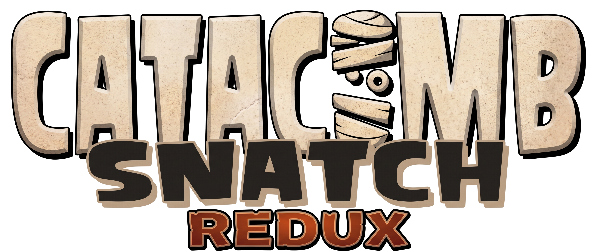

<p align="center">
  
</p>

<br/>

**Catacomb Snatch Redux** is a TypeScript rewrite of the classic open-source game **Catacomb Snatch**, originally created by Mojang for the Humble Bundle charity event. The game is a 2D top-down shooter/RTS where you defend your catacombs against waves of enemies using towers, weapons, and resource collection.

▶ **Play it:** https://evincars.github.io/Catacomb-Snatch-Redux/

### Tech Stack

| Technology | Role |
|---|---|
| [TypeScript](https://www.typescriptlang.org/) | Type-safe language replacing the original Java |
| [PixiJS](https://pixijs.com/) | 2D WebGL rendering engine |
| [Miniplex](https://github.com/hmans/miniplex) | Entity Component System (ECS) for game logic |
| [Yuka](https://mugen87.github.io/yuka/) | Game AI: graph search (A*, Dijkstra, BFS), steering, goal arbitration, math helpers |
| [rbush](https://github.com/mourner/rbush) | R-tree spatial index for the computer players' senses |
| [PeerJS](https://peerjs.com/) | WebRTC peer-to-peer co-op and versus |
| [Vite](https://vitejs.dev/) | Build tooling and dev server |

The architecture follows a strict ECS pattern: all game objects are entities with components (data), and systems operate on them each tick. Rendering is handled by PixiJS with spritesheets loaded from Tiled-compatible `.tmx` level files.

### Getting started localy

**Prerequisites:** Node.js 22+

```bash
# Install dependencies
npm install

# Start dev server
npm run dev

# Run gameplay regression tests
npm test

# Build for production
npm run build
```

The dev server runs at `http://localhost:5173`. The production build outputs to `dist/`.

In VS Code, run the **Dev server** task to serve at `http://localhost:5199/`.
Keep the server running while playing: map previews and levels are fetched when opened.

### Gameplay fidelity

- Mob populations are bounded, with mixed-species density checks across tile-region boundaries
  and fewer reinforcements while a player is surrounded. Normal and Hard use the same spawn
  amounts (up to 220 mobs, 12 within five tiles of a nest, with random nests capped at 32); Hard
  retains health regeneration. Nightmare raises those limits only modestly to 270 mobs and 40 nests;
  Easy uses 150 and 22.
  Each nest keeps at most 6 of its own mobs alive. Random nests cycle through bats, snakes,
  mummies and scarabs so every kind turns up, bats being the most common. Mobs steer around pits.
  A new map opens with half the nest cap already placed (never near either base), and a
  random nest placement is attempted every second. Map-authored nests are preserved and still
  obey the mob limits. Nests produce every 5 seconds on Normal/Hard, 4 on Nightmare and 6 on Easy.
- The computer opponent is the default. The opponent and AI level picked on the difficulty
  screen are saved with the other settings; a map without a second base, an enemy match or a
  loaded save no longer clears them. Pressing the AI level button also selects the computer.
- When nests can reach its base, the AI builds its home turrets before saving for a bomb;
  walled into its base with nothing to fight, it buys the bomb first.
- Feet may overhang a hole's edge by 6 pixels while still supported by adjacent floor.
  Falling starts only when the small foot-support box is fully over a hole.
- The level picker puts Cancel on the left and Start on the right. Pause > Main asks for
  confirmation before discarding the match; Cancel or Escape returns to the still-paused game.
- Base equipment prices are 75 coins for a turret, 300 for a harvester, and 500 for a bomb.
  Turret and harvester upgrades cost 500 and 1,000 coins. Prices retain the selected difficulty multiplier.
- Bombs make a quick, 25-pixel directional toss rather than snapping to a tile centre.
  Walls and structures shorten the toss, keeping the bomb beside the obstacle.
- Carriage purchases wait until the spawn track is clear. Carriages stay on connected track through
  bends and reversals; meeting allied carriages exchange a full and empty pot before turning around,
  relaying treasure home along a crowded single track.
- Treasure chests cannot be shot apart or carried. Focus a closed chest and press the use key
  to release mixed treasure. Coins and gems scatter in a short airborne arc before collection begins.
  The open chest disappears after 100 ticks with the bat's effect and sound.
- Collecting treasure creates pickup sparkles and a faint, one-tick flash, with a gap between flashes
  even during continuous collection. Firing makes approaching coins coast to a stop rather than
  freeze abruptly; releasing fire resumes collection. Grounded coins within 16 pixels are picked
  up immediately, even while firing; airborne drops finish scattering before they can be collected.
- Harvesters start with a 60-pixel range. Each upgrade adds one 32-pixel tile: 92 pixels at level two
  and 124 pixels at level three.
  Focus brackets sit around the body rather than the tall antenna.
- Cracked-floor traps deepen on each separate visit and collapse on the third, animating into holes.
  Falling players rotate and descend behind the foreground floor without shrinking, accompanied by
  an exclamation mark. Trap progression and airborne loot are included in saves and co-op snapshots.
  TMX remains the map source; matching bitmap pixels with colour `#0000cc` restore cracked floors
  in the centred map interior (an eight-tile border for the shipped 48×48 bitmaps and 64×64 maps).
- DevMap uses the original bitmap's 48×48 layout, including chests, placed turrets, and spike traps,
  with the standard bases around it. Traps use four animation frames, 10-tick active steps and a
  100-tick rest; the original staggered variants start 30 or 60 ticks later. They hurt grounded
  entities, not flying bats, and prevent building on their tiles.

Terrain is batched with PixiJS v8's own `ParticleContainer` (one per sheet, see `src/render/StaticTileLayer.ts`)
instead of a full-map render texture. Animated actors, pickups,
effects, harvesters, spikes and cracked floors use PixiJS `AnimatedSprite`. Their frames are driven
by the game loop with automatic ticker updates disabled, preserving pause, save and co-op timing.
The renderer uses a 512×384 logical viewport at 2× resolution, with an unscaled stage so terrain,
actors, pointer coordinates and collision tiles all share the same world coordinates.

## Multiplayer and saves

- Choose **Host multiplayer** from the main menu and select **Guests: Companions** (up to three
  guests, four players in all) or **Guests: Enemy** (one guest, one against one), then copy the
  invite link and send it to the other players. Once at least one has connected, the host chooses
  the map, difficulty and character, then starts the game. The room closes when the match starts.
- Guests can open the link directly or paste it into **Join multiplayer**. In the lobby every player
  types a name (or opens **Options** and sets **Multiplayer name** there); the lobby lists everyone
  in the room. Names are unique within a room, at most 12 letters, digits, spaces, `_`, `.` or `-`.
  Companions fight the existing AI on Team One and start side by side.
  Enemies use opposing teams and their own spawn points. All players use the host's character
  without any tint; a small translucent name plate floats above every *other* player's head, and
  nobody sees their own. A guest who leaves is removed from the match; if every guest leaves the
  host's game pauses.
- The host runs the authoritative simulation. Guests send controls, not positions or money;
  compressed world snapshots synchronize players, enemies, buildings, loot, terrain and progression.
  Positional sound effects and game notices are forwarded to the guests as well.
  Each player has their own controls, camera, inventory and purse. Combined carried coins count
  toward victory. A player killed in co-op waits out a 10-second countdown at their home base, then
  respawns there with full health and brief protection; the teammate's game continues.
  Single-player death behavior is unchanged.
- A fallen player (or computer) leaves **90% of their coins** where they fell, as the largest pickups
  that fit (diamonds, rubies, emeralds, then coins) that blink and vanish like any loose coin, and
  **every gun except the starting rifle** as a ground icon anyone without that gun can walk over
  and take (guns vanish after 40 seconds).
- In enemy mode, guns and turrets can damage opposing players, turrets, harvesters and
  carriages. Bombs also damage enemy equipment and destroy enemy-built rails; gunfire
  cannot destroy rails. Opposing equipment cannot be picked up, drained or upgraded.
  Carriages are purchased and unload on their own team's base track.
- Enemy-mode deaths show a centred **10-second respawn countdown**. The dead player
  cannot move, fire, interact or collect coins until respawning at their own base.
  Players inside their own base area are protected from opponent damage, but can fire
  outward. Leaving that area immediately removes this protection.
- Enemy victory depends on **delivered treasure**, not coins carried or spent.
  Each full carriage delivery adds **2%**, matching the original versus game; the carriage
  just empties, with no emerald and no sound. The bottom HUD shows both teams' delivered percentages.
  The first team to reach 100% wins. Companions retain combined-carried-coin victory.
- **~ opens a console** (single-player only; rebindable under Key Bindings) for testing:
  `/money <amount>`, `/god [on|off]`, `/speed <0.25-10>` and `/speed normal`; `/help` lists them and
  ~ or Esc closes it.
- **Holding Tab** in a match with company shows the players' standings: name, level (star) and coins.
  With at least one co-op player, the bottom HUD labels each side as a team ("LORD LARD TEAM"), the
  computers' side included.
- The host's pause menu pauses the world; the guest's pause menu only stops their own controls.
  A lost connection pauses the host's run, where it can still be saved. Return to the main menu
  and reload that save to reconnect with a new invite.
- Use **Save game** from the single-player or host pause menu to create a named save or replace
  an existing one. **Saved games** in the main menu supports loading and deleting saves.
  Replacement and deletion ask for confirmation. Saves include the complete world and both
  players' progression, multiplayer mode, delivered treasure and pending respawn countdowns,
  but not the old network connection. Loading a multiplayer save creates a fresh
  host lobby and invite, with the saved mode locked; the match starts once as many guests as the
  save had have reconnected, and they take their saved characters in joining order.
- Saves use this browser's local storage for this site/origin. Clearing site data removes them,
  and a different browser or device will not have them. Storage and connection errors are shown
  explicitly rather than treated as successful saves or joins.

PeerJS uses WebRTC data channels and its public PeerServer for signaling. An internet connection
is needed to establish the session; no application game server is required. Deploy on HTTPS
(localhost also works). Some restrictive networks/NAT combinations may require a separately
configured TURN relay; this version does not bundle or operate one. Keep the host tab open.
Invite links grant access to the session, so share them only with the intended player.

## Computer opponent

- On the difficulty screen, toggle **Opponent: AI** and cycle **AI: Easy / Normal / Hard / Insane**.
  This works in single-player and with companion guests (not with an enemy guest). The AI takes the
  second base and races the player (or all companions, who share one score line) to 100% delivered
  treasure, using the enemy-mode rules above. It picks a random character different from the host's.
- There is **one computer opponent per human player**: two players face two computers, four face
  four. A lone computer does everything. With several, they alternate roles: the **builder** (first,
  third) lays track, runs carriages and fetches the treasure; the **saboteur** (second, fourth) buys
  bombs and blows up the people's laid rails, turrets, harvesters and carriages, shooting the
  machines it cannot bomb.
- Every computer player starts with **5000 coins** and spends them on the **plasma gun first**.
- The bottom HUD shows each side's name and delivered percentage in the original style.
- The AI is an ordinary player entity driven by synthetic controls, so it follows every game rule.
  It fights mobs and opposing players, collects coins, builds turrets and puts harvesters near them,
  empties harvesters, buys better guns, plans and lays track to the treasure, blows open cracked
  walls in the way with bombs, buys carriages and upgrades its equipment.
- When it is carrying a building and a rival or a mob comes into sight it puts the load down on the
  spot to fight (it cannot shoot with full hands), then goes back for it and sets it where it belongs.
- It picks the gun for the situation: distance, how fast the target moves (slow shots at runners are
  discounted) and whether the target is standing still. On Normal and above, when a rival hides behind
  a wall it rehearses the plasma gun's ricochets (the same bounce, speed-up and range rules as the real
  shot), and if a line of fire exists that comes round the corner it stands still and fires it.
- Its choices are read from the shop stalls, weapon stats and building definitions (cost, role,
  range, damage), so new guns, turrets or harvesters are used without changes to the AI.
- It is aggressive about winning: it defends its home, turrets and track against rivals and their
  carriages, hunts rivals within reach, wrecks their machines, and bombs the rival's track whenever
  it has joined to it or it simply lies in reach. Turrets go where one covers the most bare track in
  clear sight (a bend beats a straight), spread apart, and are upgraded early when their longer circle
  covers ground that matters. Higher difficulties are more aggressive and run more turrets.
- It walks like a person: along a straight stretch it aims at the far end and holds its lane within a
  few pixels, and a movement key cannot flip to its opposite within a few ticks, so it no longer
  twitches left and right.
- Turret upgrades are only bought when the longer reach covers enough new ground with a clear line:
  corners where someone steps into view, the rival's track, the home base and the treasure count
  extra, a turret at the end of a bare corridor is not upgraded.
- When it lays track it joins the rival's already-laid track where that is cheaper, so its carriages
  collect from the same treasure. A saboteur (or a lone computer once the two networks are joined)
  goes for the rival's laid track next to their base first: cut there, the rival's carriages cannot
  get home to deliver. Rivals standing protected in their own base are never shot at.
- Difficulty changes reaction time, aim error, fire rate, engagement range, how many turrets and
  carriages it runs, upgrade level, how early it starts laying track, sprinting and when it retreats.
  Hard and Insane AIs also pay 10% / 20% less in their own shop.
- The AI plans its track along the shortest route and blasts cracked walls instead of detouring.
  Every difficulty opens reachable cracked barriers before its rail-building delay and reserves
  the bomb's price before spending on other equipment. Even Easy retreats when badly hurt;
  all difficulties flee lit bombs and only deliberately ignite them from outside the blast.
  It never builds on or right beside rails (players can't build on rails either).
- Opening defenses take priority over rail construction: two home turrets on Easy and three on
  Normal/Hard/Insane, spaced around the base without obstructing its tracks. Bombs can still open
  a sealed exit when needed. Carriages are staged on connected unfinished lines from six outward
  rail tiles, sized roughly one per twelve tiles and limited to two before reaching treasure.
  Purchases are spaced ten seconds apart and retain each AI difficulty's fleet limit.
- Each base's turret/harvester/bomb stalls sit on the side of the flag away from its rails. A rival
  base's prices are hidden and its stalls can't be used.

## Original Game

Catacomb Snatch was originally created by Mojang for the 2012 Humble Bundle charity event and later released open-source.

- Original repository: https://github.com/Mojang/CatacombSnatch
- Modified version reference: https://catacombsnatch.net

This project is an independent fan rewrite using modern web technologies, preserving the core gameplay while replacing the entire Java codebase with TypeScript and a component-based architecture.

## License

This project is licensed under the **GNU General Public License v3.0** (GPLv3) - see the [LICENSE](LICENSE) file for details.

### Attribution
Based on the original open-source release of [Catacomb Snatch](https://github.com/Mojang/CatacombSnatch) by Mojang Studios, originally released under the MIT License.

## Deployment

The game is automatically built and deployed to **GitHub Pages** on every new version tag.

1. Update the `version` field in `package.json` (e.g. `"version": "0.1.1"`)
2. Commit the change
3. Push a matching tag:
   ```bash
   git tag v0.1.1
   git push origin v0.1.1
   ```

## Computer player architecture

The computer players live in `src/ai/`, split the way a game AI usually is:

- **Perception** (`src/ai/perception/`) reads the world. Positions of people, mobs, nests, machines,
  loot and bombs are kept in a spatial index (**rbush**, an R-tree, rebuilt once per tick);
  walking distances come from **yuka**'s `Dijkstra` and point-to-point routes from its `AStar`, both over one
  `TileGraph` (a yuka `Graph` of the level, `src/level/TileGraph.ts`) whose step costs are supplied per search,
  so both agree and the graph never has to be rebuilt when the floor changes. Mobs and the track planner use
  the same graph. Also here: track planning, turret placement and upgrade value, sabotage targets,
  gun ratings and the ricochet solver.
- **Decision** (`src/ai/decision/`) is Utility AI on **yuka**'s goal-driven design: perception builds one
  `Situation`; each `Option` (survival, carrying, shopping and building, offence, errands) is a yuka
  `GoalEvaluator` scoring itself against it, and a yuka `Think` arbiter makes the best score the goal.
  Options declare a score ceiling so those that cannot win are not evaluated. How hard the computer's
  gunfire hits per difficulty and gun (`AI_GUN_DAMAGE`) and the coins it gets on each death
  (`AI_DEATH_GOLD`) live in `src/ai/constants.ts`.
- **Execution** (`src/ai/execution/`) turns the goal into key presses: walking uses **yuka** steering
  (follow-path towards the farthest point in clear sight, plus separation from people crowding it), with
  keys that cannot flip instantly; fighting aims, leads targets, picks the gun and fires ricochets.
